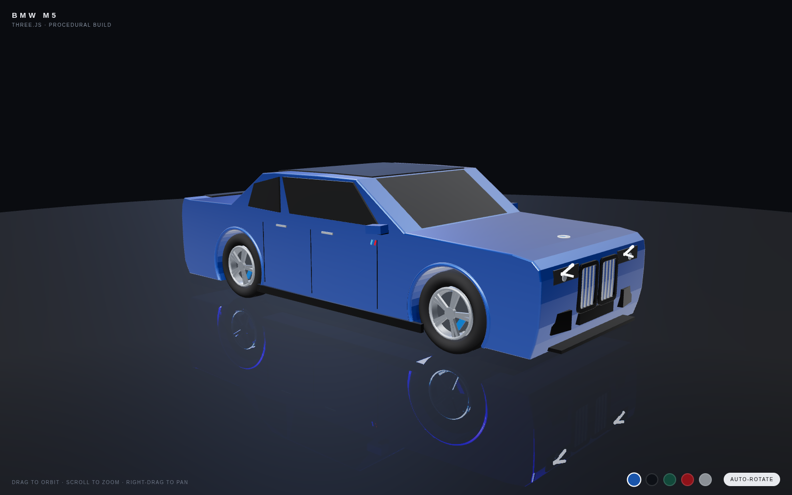

# BMW M5 — Three.js

A procedural 3D BMW M5 built entirely from Three.js geometry — no model files,
no textures, just code. Sits in a dark showroom with a mirror floor.

## Run it

ES modules need to be served over HTTP (opening `index.html` directly will not
work in most browsers):

```sh
cd "BMW car"
python3 -m http.server 8137
```

Then open <http://localhost:8137/>. Three.js itself loads from the jsDelivr CDN,
so the page needs an internet connection.

## Controls

- **Drag** — orbit
- **Scroll** — zoom
- **Right-drag** — pan
- Paint swatches (bottom right) switch between M5 colours
- **Auto-rotate** toggles the turntable

## How it is built

| File            | What it does                                                  |
| --------------- | ------------------------------------------------------------- |
| `index.html`    | Page shell, HUD, import map                                   |
| `js/main.js`    | Renderer, showroom, lights, floor, controls, paint swatches   |
| `js/car.js`     | The car itself                                                 |

The body is an extruded side profile with the wheel arches cut into the
silhouette (`sideProfile()`), finished with glazing, wheels, grille, lights and
trim. Everything is dimensioned off the real F90 5-series footprint: 4.98 m
long, 1.90 m wide, 2.98 m wheelbase.

`window.__m5` exposes `{ scene, camera, controls, car }` for tinkering from the
browser console.


